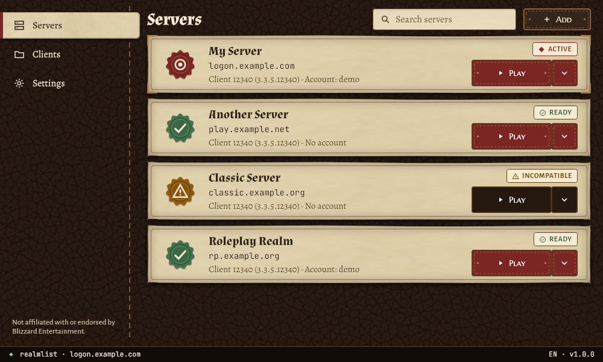

<p align="center">
  
</p>

<h1 align="center">Realm Portal</h1>

<p align="center"><em>Gestiona tus servidores privados de World of Warcraft y cambia el cliente del juego entre ellos.</em></p>

<p align="center"><a href="README.md">English</a> · Español</p>

<p align="center">
  <a href="https://github.com/KarloZ7715/realm-portal/actions/workflows/ci.yml"></a>
  <a href="LICENSE"></a>
</p>

## Qué hace

Realm Portal es una aplicación de escritorio para servidores privados de World of Warcraft. Registra los servidores en los que juegas (nombre, dirección, reino, cuenta y build de cliente requerida), busca clientes del juego en tu equipo y apunta el cliente que elijas al servidor que selecciones.

Al cambiar de servidor, Realm Portal escribe la configuración de conexión en el `realmlist.wtf` y el `WTF/Config.wtf` del propio cliente, y antes guarda una copia de esos archivos. La aplicación de escritorio hace el cambio y abre el juego; la línea de comandos expone las mismas operaciones de servidor para scripts y uso sin interfaz. La interfaz está disponible en español e inglés.

<p align="center">
  
  <br>
  <em>La pantalla Servidores, con servidores de ejemplo.</em>
</p>

## Compatibilidad y requisitos

- **Clientes del juego** (según su distribución de archivos, ver [docs/client-files.md](docs/client-files.md)): 1.12.1 (build 5875), 2.4.3 (8606), 3.3.5a (12340), 4.3.4 (15595) y la distribución 5.4.8. Otras versiones no están soportadas.
- **Sistemas operativos**: Linux x64 y Windows x64.
- **Entorno de Linux**: un servidor X11 (o XWayland) y `libfontconfig1`, `libfreetype6`, `libx11-6`, `libice6`, `libsm6`.
- Las compilaciones publicadas para Linux y Windows son autocontenidas: no necesitan un runtime de .NET aparte.
- El cliente del juego lo aportas tú; Realm Portal no incluye ni descarga archivos del juego.

## Instalación

Descarga la compilación de tu plataforma desde [Releases](https://github.com/KarloZ7715/realm-portal/releases):

- **Linux — `.deb`**: instala el paquete con el gestor de paquetes de tu distribución.
- **Linux — `.AppImage`**: dale permiso de ejecución y ejecútalo.

```bash
chmod +x RealmPortal-*-x86_64.AppImage
./RealmPortal-*-x86_64.AppImage
```

- **Windows — `.zip`**: descomprímelo y ejecuta `RealmPortal.App.exe`.

## Uso de la aplicación de escritorio

1. En el primer arranque, Realm Portal busca en las ubicaciones habituales (Steam, Lutris, prefijos de Wine y Bottles, y carpetas de juegos comunes) y registra los clientes y servidores que encuentra.
2. En **Clientes**, revisa las instalaciones detectadas y marca como **En uso** las que puedas lanzar. Usa **Buscar de nuevo** para repetir la búsqueda, o **Elegir carpeta a mano** para añadir una instalación manualmente.
3. En **Servidores**, selecciona **Añadir** e introduce el nombre y la dirección del servidor (`host` o `host:puerto`), y de forma opcional el reino, la cuenta y el cliente de destino.
4. Selecciona un servidor y pulsa **Jugar** para cambiar los archivos del cliente y abrir el juego, o **Solo cambiar** para modificar los archivos sin lanzarlo. Los servidores incompatibles con el cliente seleccionado quedan deshabilitados.
5. Tras un cambio, el aviso de Deshacer devuelve el cliente al servidor anterior. Los archivos del cliente se respaldan antes de cada cambio (ver [Copias de seguridad y recuperación](#copias-de-seguridad-y-recuperación)).

## Uso de la línea de comandos

`realm-portal` gestiona los servidores sin la aplicación. Los comandos son `add`, `remove`, `edit`, `list`, `switch`, `undo`, `status`, `launch`, `client` (`list`, `add`, `edit`, `remove`) y `scan`, además de `--version` y `client-version <carpeta-del-cliente>`.

```bash
realm-portal add "Warmane" logon.warmane.example.org --realm Icecrown --build 12340
realm-portal list --client-dir "/path/to/client"
realm-portal switch "Warmane" --client-dir "/path/to/client"
realm-portal launch "Warmane" --client-dir "/path/to/client"
realm-portal undo
realm-portal status --client-dir "/path/to/client"
realm-portal client list
realm-portal scan --root /games
```

Opciones comunes: `--config-dir`, `--projection-dir` y `--client-dir` apuntan la herramienta a su carpeta de configuración, a la carpeta de `activo.json` y al cliente del juego. `--all` lista todos los servidores, `--force` omite la comprobación de compatibilidad, `--dry-run` imprime el comando de lanzamiento en lugar de abrir el juego, y `--wrapper <comando>` ejecuta el juego a través de un comando como `wine`. Con `--client-dir`, `switch` también edita los archivos del cliente; sin él, solo actualiza el estado propio de Realm Portal. `--verbose` imprime mensajes de error detallados; los códigos de salida son `0` (éxito), `1` (uso incorrecto) y `2` (fallo).

## Copias de seguridad y recuperación

Realm Portal escribe una copia de seguridad antes de cambiar cualquier archivo del cliente, de modo que cada cambio se puede deshacer byte a byte.

- **Automática**: cada cambio guarda el contenido anterior de `realmlist.wtf` y `WTF/Config.wtf` en la carpeta de respaldos (`~/.local/share/realm-portal/backups` por defecto) y conserva los 10 respaldos más recientes por cliente (el motor admite entre 1 y 50).
- **Deshacer**: `realm-portal undo`, o el aviso de Deshacer en la aplicación, restaura el servidor que estaba activo antes del último cambio. Recuerda un solo paso. Si los archivos del cliente cambiaron a mano desde el cambio, Realm Portal pregunta antes de sobrescribirlos.
- **Manual**: en **Ajustes → Copia de seguridad**, usa **Gestionar respaldos…** para crear un respaldo, ver los guardados, restaurar uno anterior o eliminarlo. Los respaldos se guardan en la carpeta indicada en **Carpeta de respaldos**.

La carpeta de respaldos y las demás ubicaciones se pueden sobrescribir con `REALM_PORTAL_BACKUP_DIR`, `REALM_PORTAL_CONFIG_DIR` y `REALM_PORTAL_PROJECTION_DIR`.

## Alcance y avisos legales

- Realm Portal **no está afiliado ni respaldado por Blizzard Entertainment**.
- **No** descarga ni distribuye clientes ni contenido del juego; usas tu propia copia.
- **No incluye lista de servidores**; añades los servidores en los que quieres jugar.
- Admite **solo servidores privados**.
- Solo escribe el `realmlist.wtf` y el `WTF/Config.wtf` del cliente; el resto de archivos del juego no se toca.

## Compilación y desarrollo

Las instrucciones de compilación, las pruebas, la referencia de la línea de comandos y la estructura del proyecto están en [CONTRIBUTING.md](CONTRIBUTING.md).

## Licencia y créditos

MIT. Ver [LICENSE](LICENSE). Las licencias de los paquetes de terceros están en [THIRD_PARTY_LICENSES.md](THIRD_PARTY_LICENSES.md).

El icono de la aplicación («Tesera»), el kit de interfaz, los sellos y los iconos son obra original, con licencia MIT (ver [assets/branding/LICENSE-ART.md](assets/branding/LICENSE-ART.md)). Las texturas proceden de [ambientCG](https://ambientcg.com) bajo CC0 1.0, y las tipografías incluidas proceden de [Google Fonts](https://github.com/google/fonts) bajo la SIL Open Font License 1.1. No se usa ningún recurso de Blizzard.
